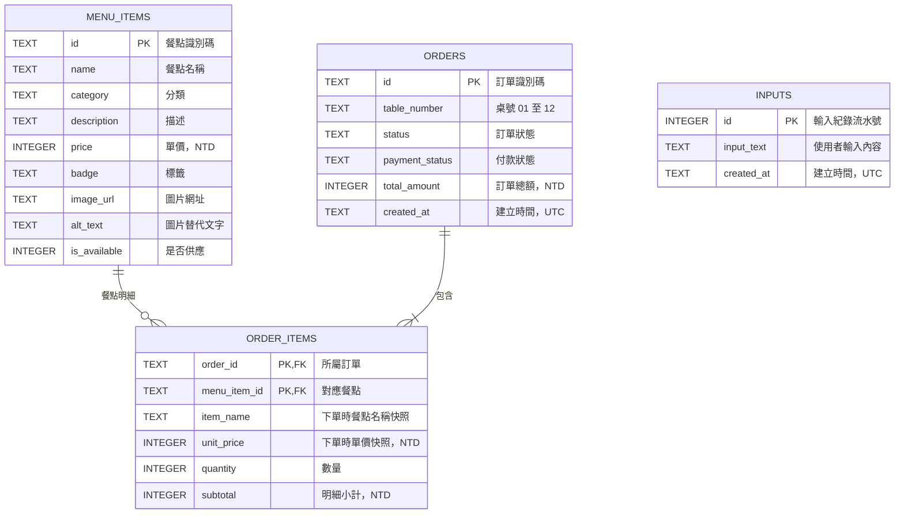

# 後端 API 規格

## 目的

使用 Python FastAPI 建立點餐 Web API。菜單與訂單資料使用 SQLite 儲存；前端由同一個 FastAPI 服務提供。

## 檔案位置

- API 程式：`src/main.py`
- 資料庫初始化：`src/database.py`
- SQLite 資料庫：`data/pos.db`
- 前端檔案：`web/`

## SQLite 資料庫設計

- 資料庫引擎：SQLite。
- 金額以新台幣整數儲存，不使用浮點數。
- 時間以 UTC ISO 8601 文字儲存。

### ER 關聯圖



### 資料表欄位

#### `menu_items` 餐點

| 欄位 | SQLite 型態 | 限制／預設值 | 說明 |
| --- | --- | --- | --- |
| `id` | TEXT | 主鍵 | 餐點識別碼，例如 `sunny-plate`。 |
| `name` | TEXT | NOT NULL | 餐點名稱。 |
| `category` | TEXT | NOT NULL；建立索引 | 餐點分類。 |
| `description` | TEXT | NOT NULL | 餐點描述。 |
| `price` | INTEGER | NOT NULL，`>= 0` | 餐點單價，新台幣元。 |
| `badge` | TEXT | NOT NULL | 菜單顯示標籤。 |
| `image_url` | TEXT | NOT NULL | 餐點圖片網址。 |
| `alt_text` | TEXT | NOT NULL | 圖片替代文字。 |
| `is_available` | INTEGER | NOT NULL，預設 `1`，限 `0` 或 `1` | 是否供應；`1` 為供應，`0` 為停售。 |

#### `orders` 訂單

| 欄位 | SQLite 型態 | 限制／預設值 | 說明 |
| --- | --- | --- | --- |
| `id` | TEXT | 主鍵 | 訂單識別碼，由後端產生。 |
| `table_number` | TEXT | NOT NULL，限 `01` 至 `12` | 用餐桌號。 |
| `status` | TEXT | NOT NULL，預設 `received` | 訂單狀態；可為 `received`、`preparing`、`ready`、`completed` 或 `cancelled`。 |
| `payment_status` | TEXT | NOT NULL，預設 `unpaid` | 付款狀態；可為 `unpaid`、`paid` 或 `refunded`。 |
| `total_amount` | INTEGER | NOT NULL，`>= 0` | 訂單總額，新台幣元。 |
| `created_at` | TEXT | NOT NULL，預設資料庫 UTC 時間 | 訂單建立時間，ISO 8601 格式。 |

#### `order_items` 訂單明細

| 欄位 | SQLite 型態 | 限制／預設值 | 說明 |
| --- | --- | --- | --- |
| `order_id` | TEXT | 複合主鍵之一；外鍵參照 `orders.id`，刪除訂單時連帶刪除 | 所屬訂單識別碼。 |
| `menu_item_id` | TEXT | 複合主鍵之一；外鍵參照 `menu_items.id`，限制刪除被引用餐點 | 餐點識別碼。 |
| `item_name` | TEXT | NOT NULL | 下單當下的餐點名稱快照，保留歷史訂單名稱。 |
| `unit_price` | INTEGER | NOT NULL，`>= 0` | 下單當下的單價快照，新台幣元。 |
| `quantity` | INTEGER | NOT NULL，`> 0` | 餐點數量。 |
| `subtotal` | INTEGER | NOT NULL，必須等於 `unit_price * quantity` | 明細小計，新台幣元。 |

主鍵為 `(order_id, menu_item_id)`，同一筆訂單的同一餐點以一列明細及數量表示。

#### `inputs` 使用者輸入紀錄

| 欄位 | SQLite 型態 | 限制／預設值 | 說明 |
| --- | --- | --- | --- |
| `id` | INTEGER | 主鍵，自動遞增 | 輸入紀錄流水號。 |
| `input_text` | TEXT | NOT NULL | `/input` API 收到的文字內容。 |
| `created_at` | TEXT | NOT NULL，預設資料庫 UTC 時間 | 紀錄建立時間，ISO 8601 格式。 |

### 外鍵與連線規則

- 一筆 `orders` 可包含多筆 `order_items`；每筆明細對應一個 `menu_items` 餐點。
- SQLite 外鍵檢查需對每個資料庫連線執行 `PRAGMA foreign_keys = ON`。
- 訂單明細引用中的菜單餐點不可刪除；停售餐點應將 `is_available` 設為 `0`。

## API 清單

| 編號 | 方法 | 路由 | 用途 | 實作狀態 | 測試通過 |
| --- | --- | --- | --- | --- | --- |
| 1 | GET | `/hello` | 回傳指定問候文字 | 未實作 | [ ] |
| 2 | POST | `/input` | 將使用者文字存入 SQLite `inputs` | 未實作 | [ ] |
| 3 | GET | `/api/menu` | 取得供應中的菜單 | 已實作 | [X] |
| 4 | POST | `/api/orders` | 建立訂單並存入 SQLite | 已實作 | [X] |

## 1 號：問候文字

- 目的：傳回固定問候字串。
- 路由：`/hello`
- 方法：`GET`
- 輸入：無
- 成功輸出：HTTP 200

```json
{
  "text": "Hello, World!"
}
```

- 測試方式：呼叫 API，確認回應 JSON 的 `text` 等於 `Hello, World!`。
- 測試通過：[ ]

## 2 號：儲存使用者輸入

- 目的：保存使用者輸入文字及建立時間。
- 路由：`/input`
- 方法：`POST`
- 輸入：`input` 為必填文字。

```json
{
  "input": "使用者輸入的資料"
}
```

- 儲存位置：SQLite `data/pos.db` 的 `inputs` 資料表，不使用 Excel。
- 成功輸出：HTTP 200

```json
{
  "text": "OK"
}
```

- 測試方式：連續送出三筆不同的隨機字串，檢查 `inputs.input_text` 均已保存，並確認每次回應為 `OK`。
- 測試通過：[ ]

## 3 號：取得菜單

- 目的：提供前端顯示的供應中餐點；資料來源為 SQLite `menu_items`。
- 路由：`/api/menu`
- 方法：`GET`
- 輸入：無
- 成功輸出：HTTP 200；只回傳 `is_available = 1` 的餐點。

```json
{
  "items": [
    {
      "id": "sunny-plate",
      "name": "美式陽光早午餐盤",
      "category": "招牌早午餐",
      "description": "太陽蛋、香煎培根、薯餅與奶油吐司，一盤開啟好早晨。",
      "price": 220,
      "badge": "人氣招牌",
      "image": "https://example.com/menu.jpg",
      "alt": "早餐盤"
    }
  ]
}
```

- 欄位說明：`id` 為餐點識別碼；`price` 為新台幣整數；`image` 為圖片網址；`alt` 為圖片替代文字。
- 測試方式：呼叫 API，確認回應是 JSON、欄位完整；新增或修改 SQLite 菜單資料後再次呼叫，確認回應反映資料庫內容；停售餐點不得出現在回應中。
- 測試通過：[X]

## 4 號：建立訂單

- 目的：使用桌號及餐點建立訂單，將訂單主檔和明細一併存入 SQLite。
- 路由：`/api/orders`
- 方法：`POST`
- 輸入：

```json
{
  "table_number": "01",
  "items": [
    {
      "menu_item_id": "sunny-plate",
      "quantity": 2
    }
  ]
}
```

- 輸入限制：
  - `table_number` 必須為 `01` 至 `12`。
  - `items` 至少一筆，最多 50 筆。
  - `menu_item_id` 必須對應供應中的餐點。
  - `quantity` 為 1 至 99 的整數；同品項重複傳入時會合併計算，合計不可超過 99。
  - 用戶端不得指定價格；後端以資料庫菜單價格計算單價、小計及總額。
- 成功輸出：HTTP 201；訂單狀態為 `received`，付款狀態為 `unpaid`。

```json
{
  "order": {
    "id": "由伺服器產生的訂單識別碼",
    "table_number": "01",
    "status": "received",
    "payment_status": "unpaid",
    "total_amount": 440,
    "created_at": "2026-11-06T08:00:00.000Z",
    "items": [
      {
        "menu_item_id": "sunny-plate",
        "name": "美式陽光早午餐盤",
        "unit_price": 220,
        "quantity": 2,
        "subtotal": 440
      }
    ]
  }
}
```

- 儲存方式：在單一 SQLite 交易中新增 `orders` 訂單主檔及 `order_items` 明細；任一新增失敗時整筆交易回復。
- 錯誤回應：桌號、數量或餐點資料不合法時回傳 HTTP 422，且不得留下部分訂單。
- 測試方式：送出有效訂單後，確認回應訂單編號可在 `orders.id` 查到，明細可在 `order_items` 查到，且資料庫總額與回應總額相同；另測試不合法桌號及不存在／停售餐點，確認回傳 HTTP 422 且沒有新增資料。
- 測試通過：[X]

## 測試原則

- 每支 API 都必須有成功及適用的錯誤情境測試。
- 只有完成測試並確認資料正確後，才能將 `測試通過` 標記為 `[X]`。
- 訂單測試應使用可清理的測試資料或獨立測試資料庫，不得留下測試訂單。

## 啟動方式

在專案根目錄執行 `run.bat` 啟動後端。預設網址為 `http://127.0.0.1:8001`；若要指定其他埠，可先設定 `PORT` 環境變數，例如：

```powershell
$env:PORT = "8002"
.\run.bat
```

啟動時會確保 SQLite 資料表存在。
