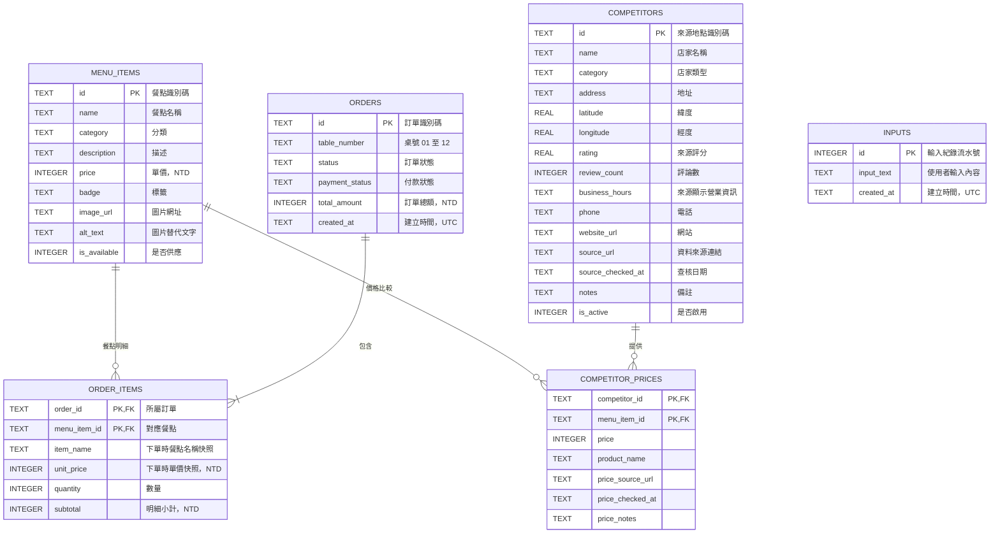

# 後端 API 規格

## 目的

使用 Python FastAPI 建立點餐 Web API。菜單與訂單資料使用 SQLite 儲存；前端由同一個 FastAPI 服務提供。
店家管理 API 使用環境變數設定的單一管理帳號，管理者密碼不存入 SQLite。

## 跨源存取（CORS）

- 允許所有來源、所有 HTTP 方法及所有請求標頭。
- 不允許跨源憑證（`allow_credentials = false`），因此瀏覽器跨源請求不會攜帶管理 session cookie。

## 檔案位置

- API 程式：`src/main.py`
- 店家管理 API：`src/admin.py`
- 資料庫初始化：`src/database.py`
- SQLite 資料庫：`data/pos.db`
- 前端規格：`spec/早餐店規格/frontend.md`
- ER 圖與欄位字典：`spec/早餐店規格/er.md`、`spec/早餐店規格/er.jpg`
- 前端檔案：`web/`

## 店家管理與資料庫調整

- 會員可使用台灣手機及密碼註冊、登入，透過 `/api/members/session`、`/api/members/me/points` 及 `/api/members/me/points/transactions` 查詢本人資料；登出為 `POST /api/members/logout`。註冊與登入分別為 `POST /api/members/register`、`POST /api/members/login`，JSON 含 `phone`、`password`。
- `POST /api/orders` 繼續支援訪客；會員由 session 綁定，可選填整數 `points_redeemed`。回應包含 `points_redeemed`、`points_discount_amount`、`payable_amount`；價格及點數由後端驗證。
- 累點與退款規則、登入限制及 SQLite 表設計見 [會員紅利計畫](../紅利績點/計畫書.md)及[會員紅利 ERD](../紅利績點/ERD.mmd)。SQL 草案不應直接用於正式環境，應由程式遷移。
- 管理員登入後可使用 `GET /api/admin/members?query=&limit=20&offset=0` 查詢會員（手機或姓名），及 `GET /api/admin/members/{id}/transactions?limit=20&offset=0` 查詢單一會員及點數歷史。兩者回傳 `has_more` 並禁止快取；不回傳密碼雜湊。餘額不包含過期點數；查詢歷史時沿用會員查詢的到期入帳流程。

- 管理頁：`web/admin.html`；從點餐頁或營運儀表板頁尾進入。
- 管理頁的「營運概覽」頁籤與獨立 `web/dashboard.html` 共用 `GET /api/dashboard`；無需額外統計 API 或資料表。
- 菜單管理直接使用 `menu_items` 現有欄位新增、編輯與上下架；停售只更新 `is_available`，不刪除餐點，以保留訂單明細外鍵及歷史價格/名稱快照。
- 訂單處理直接使用 `orders.status`、`orders.payment_status` 與 `order_items`；可查詢訂單及更新訂單/付款狀態。
- 競業資料使用 `competitors` 與 `competitor_prices` 表，不修改既有菜單及訂單表。管理者帳密由 `ADMIN_USERNAME`、`ADMIN_PASSWORD`、`ADMIN_SESSION_SECRET` 環境變數提供，不存入資料庫。
- 競品初始候選資料來源為 Google 地圖「早餐店 上石路 台中市西屯區」搜尋結果，查核日為 `2026-11-06`；來源 URL、評分/評論數與當時顯示的營業資訊一併保存。電話與價位未查證，保持 NULL。
- 已查證的競品商品價格另存於 `competitor_prices`，每筆保留商品名稱、來源 URL、查核日期與規格差異備註。現有價格樣本是同類品項參考，不代表份量、配料或內用/外送價格完全一致；未查到的商品不建立價格列。
- 登入成功後以 8 小時簽章 session cookie 驗證管理 API；Cookie 設為 HttpOnly、SameSite=Strict，HTTPS 時設 Secure。未設定管理環境變數時，管理 API 回傳 HTTP 503。
- 部署至公開網站時必須使用 HTTPS，並以密碼管理器或部署平台密鑰設定強密碼及 session secret。

## SQLite 資料庫設計

- 資料庫引擎：SQLite。
- 金額以新台幣整數儲存，不使用浮點數。
- 時間以 UTC ISO 8601 文字儲存。

### ER 關聯圖



### 資料表欄位

#### `menu_items` 餐點

| 欄位 | SQLite 型態 | 限制／預設值 | 說明 |
| --- | --- | --- | --- |
| `id` | TEXT | 主鍵 | 餐點識別碼，例如 `sunny-plate`。 |
| `name` | TEXT | NOT NULL | 餐點名稱。 |
| `category` | TEXT | NOT NULL；建立索引 | 餐點分類。 |
| `description` | TEXT | NOT NULL | 餐點描述。 |
| `price` | INTEGER | NOT NULL，`>= 0` | 餐點單價，新台幣元。 |
| `badge` | TEXT | NOT NULL | 菜單顯示標籤。 |
| `image_url` | TEXT | NOT NULL | 餐點圖片網址。 |
| `alt_text` | TEXT | NOT NULL | 圖片替代文字。 |
| `is_available` | INTEGER | NOT NULL，預設 `1`，限 `0` 或 `1` | 是否供應；`1` 為供應，`0` 為停售。 |

#### `orders` 訂單

| 欄位 | SQLite 型態 | 限制／預設值 | 說明 |
| --- | --- | --- | --- |
| `id` | TEXT | 主鍵 | 訂單識別碼，由後端產生。 |
| `table_number` | TEXT | NOT NULL，限 `01` 至 `12` | 用餐桌號。 |
| `status` | TEXT | NOT NULL，預設 `received` | 訂單狀態；可為 `received`、`preparing`、`ready`、`completed` 或 `cancelled`。 |
| `payment_status` | TEXT | NOT NULL，預設 `unpaid` | 付款狀態；可為 `unpaid`、`paid` 或 `refunded`。 |
| `total_amount` | INTEGER | NOT NULL，`>= 0` | 訂單總額，新台幣元。 |
| `created_at` | TEXT | NOT NULL，預設資料庫 UTC 時間 | 訂單建立時間，ISO 8601 格式。 |

#### `order_items` 訂單明細

| 欄位 | SQLite 型態 | 限制／預設值 | 說明 |
| --- | --- | --- | --- |
| `order_id` | TEXT | 複合主鍵之一；外鍵參照 `orders.id`，刪除訂單時連帶刪除 | 所屬訂單識別碼。 |
| `menu_item_id` | TEXT | 複合主鍵之一；外鍵參照 `menu_items.id`，限制刪除被引用餐點 | 餐點識別碼。 |
| `item_name` | TEXT | NOT NULL | 下單當下的餐點名稱快照，保留歷史訂單名稱。 |
| `unit_price` | INTEGER | NOT NULL，`>= 0` | 下單當下的單價快照，新台幣元。 |
| `quantity` | INTEGER | NOT NULL，`> 0` | 餐點數量。 |
| `subtotal` | INTEGER | NOT NULL，必須等於 `unit_price * quantity` | 明細小計，新台幣元。 |

主鍵為 `(order_id, menu_item_id)`，同一筆訂單的同一餐點以一列明細及數量表示。

#### `inputs` 使用者輸入紀錄

| 欄位 | SQLite 型態 | 限制／預設值 | 說明 |
| --- | --- | --- | --- |
| `id` | INTEGER | 主鍵，自動遞增 | 輸入紀錄流水號。 |
| `input_text` | TEXT | NOT NULL | `/input` API 收到的文字內容。 |
| `created_at` | TEXT | NOT NULL，預設資料庫 UTC 時間 | 紀錄建立時間，ISO 8601 格式。 |

#### `competitors` 競業資料

| 欄位 | SQLite 型態 | 限制／預設值 | 說明 |
| --- | --- | --- | --- |
| `id` | TEXT | PRIMARY KEY | 來源地點識別碼。 |
| `name` | TEXT | NOT NULL | 店家名稱。 |
| `category` | TEXT | NOT NULL | 店家類型，例如早餐店或早午餐餐廳。 |
| `address` | TEXT | NOT NULL | 地址。 |
| `latitude` | REAL | 可為 NULL | 來源地圖座標緯度。 |
| `longitude` | REAL | 可為 NULL | 來源地圖座標經度。 |
| `rating` | REAL | 可為 NULL，0 至 5 | 來源顯示評分；會隨時間變化。 |
| `review_count` | INTEGER | 可為 NULL，`>= 0` | 來源顯示評論數；會隨時間變化。 |
| `business_hours` | TEXT | 可為 NULL | 查核時來源顯示的營業資訊摘要，不保證是完整週營業時間。 |
| `phone` | TEXT | 可為 NULL | 電話；目前未查證者留空。 |
| `website_url` | TEXT | 可為 NULL | 官方網站；未查證者留空。 |
| `source_url` | TEXT | NOT NULL | 可回查該店家資訊的來源連結。 |
| `source_checked_at` | TEXT | NOT NULL，`YYYY-MM-DD` | 資料查核日期。 |
| `notes` | TEXT | NOT NULL，預設空字串 | 查核及資料限制備註。 |
| `is_active` | INTEGER | NOT NULL，DEFAULT `1`，限 `0` 或 `1` | `1` 顯示於管理列表；`0` 停用但保留資料。 |

#### `competitor_prices` 競品商品價格

| 欄位 | SQLite 型態 | 限制／預設值 | 說明 |
| --- | --- | --- | --- |
| `competitor_id` | TEXT | PK、FK → `competitors.id`，ON DELETE CASCADE | 競品店家。 |
| `menu_item_id` | TEXT | PK、FK → `menu_items.id`，ON DELETE CASCADE | 對應的本店商品。 |
| `price` | INTEGER | NOT NULL，`>= 0` | 競品同類商品價格（新台幣）。 |
| `product_name` | TEXT | 可為 NULL | 競品實際品名。 |
| `price_source_url` | TEXT | 可為 NULL | 價格來源網址，與店家資料來源分開。 |
| `price_checked_at` | TEXT | 可為 NULL | 價格查核日期。 |
| `price_notes` | TEXT | 可為 NULL | 差異與收費方式等注意事項。 |

沒有對應資料列代表尚未查到價格，管理後台顯示「查無資料」；API 的 `prices` 只回傳有價格的商品。
競品表單手動改價時清除舊價格來源資訊，避免誤認為新價格已查證；價格不變時保留來源。

### 外鍵與連線規則

- 一筆 `orders` 可包含多筆 `order_items`；每筆明細對應一個 `menu_items` 餐點。
- SQLite 外鍵檢查需對每個資料庫連線執行 `PRAGMA foreign_keys = ON`。
- 訂單明細引用中的菜單餐點不可刪除；停售餐點應將 `is_available` 設為 `0`。

## API 清單

| 編號 | 方法 | 路由 | 用途 | 實作狀態 | 測試通過 |
| --- | --- | --- | --- | --- | --- |
| 1 | GET | `/hello` | 回傳指定問候文字 | 未實作 | [ ] |
| 2 | POST | `/input` | 將使用者文字存入 SQLite `inputs` | 未實作 | [ ] |
| 3 | GET | `/api/menu` | 取得供應中的菜單 | 已實作 | [X] |
| 4 | POST | `/api/orders` | 建立訂單並存入 SQLite | 已實作 | [X] |
| 5 | GET | `/api/dashboard` | 取得營運儀表板統計 | 已實作 | [X] |
| 6 | POST | `/api/admin/login`、`/api/admin/logout` | 店家管理者登入/登出 | 已實作 | [X] |
| 7 | GET/POST/PUT | `/api/admin/menu` | 查詢、新增與編輯菜單 | 已實作 | [X] |
| 8 | GET/PATCH | `/api/admin/orders` | 查詢訂單與更新狀態 | 已實作 | [X] |
| 9 | GET/POST/PUT | `/api/admin/competitors` | 查詢、新增與編輯競業資料 | 已實作 | [X] |

## 1 號：問候文字

- 目的：傳回固定問候字串。
- 路由：`/hello`
- 方法：`GET`
- 輸入：無
- 成功輸出：HTTP 200

```json
{
  "text": "Hello, World!"
}
```

- 測試方式：呼叫 API，確認回應 JSON 的 `text` 等於 `Hello, World!`。
- 測試通過：[ ]

## 2 號：儲存使用者輸入

- 目的：保存使用者輸入文字及建立時間。
- 路由：`/input`
- 方法：`POST`
- 輸入：`input` 為必填文字。

```json
{
  "input": "使用者輸入的資料"
}
```

- 儲存位置：SQLite `data/pos.db` 的 `inputs` 資料表，不使用 Excel。
- 成功輸出：HTTP 200

```json
{
  "text": "OK"
}
```

- 測試方式：連續送出三筆不同的隨機字串，檢查 `inputs.input_text` 均已保存，並確認每次回應為 `OK`。
- 測試通過：[ ]

## 3 號：取得菜單

- 目的：提供前端顯示的供應中餐點；資料來源為 SQLite `menu_items`。
- 路由：`/api/menu`
- 方法：`GET`
- 輸入：無
- 成功輸出：HTTP 200；只回傳 `is_available = 1` 的餐點。

```json
{
  "items": [
    {
      "id": "sunny-plate",
      "name": "美式陽光早午餐盤",
      "category": "招牌早午餐",
      "description": "太陽蛋、香煎培根、薯餅與奶油吐司，一盤開啟好早晨。",
      "price": 220,
      "badge": "人氣招牌",
      "image": "https://example.com/menu.jpg",
      "alt": "早餐盤"
    }
  ]
}
```

- 欄位說明：`id` 為餐點識別碼；`price` 為新台幣整數；`image` 為圖片網址；`alt` 為圖片替代文字。
- 測試方式：呼叫 API，確認回應是 JSON、欄位完整；新增或修改 SQLite 菜單資料後再次呼叫，確認回應反映資料庫內容；停售餐點不得出現在回應中。
- 測試通過：[X]

## 4 號：建立訂單

- 目的：使用桌號及餐點建立訂單，將訂單主檔和明細一併存入 SQLite。
- 路由：`/api/orders`
- 方法：`POST`
- 輸入：

```json
{
  "table_number": "01",
  "items": [
    {
      "menu_item_id": "sunny-plate",
      "quantity": 2
    }
  ]
}
```

- 輸入限制：
  - `table_number` 必須為 `01` 至 `12`。
  - `items` 至少一筆，最多 50 筆。
  - `menu_item_id` 必須對應供應中的餐點。
  - `quantity` 為 1 至 99 的整數；同品項重複傳入時會合併計算，合計不可超過 99。
  - 用戶端不得指定價格；後端以資料庫菜單價格計算單價、小計及總額。
- 成功輸出：HTTP 201；訂單狀態為 `received`，付款狀態為 `unpaid`。

```json
{
  "order": {
    "id": "由伺服器產生的訂單識別碼",
    "table_number": "01",
    "status": "received",
    "payment_status": "unpaid",
    "total_amount": 440,
    "created_at": "2026-11-06T08:00:00.000Z",
    "items": [
      {
        "menu_item_id": "sunny-plate",
        "name": "美式陽光早午餐盤",
        "unit_price": 220,
        "quantity": 2,
        "subtotal": 440
      }
    ]
  }
}
```

- 儲存方式：在單一 SQLite 交易中新增 `orders` 訂單主檔及 `order_items` 明細；任一新增失敗時整筆交易回復。
- 錯誤回應：桌號、數量或餐點資料不合法時回傳 HTTP 422，且不得留下部分訂單。
- 測試方式：送出有效訂單後，確認回應訂單編號可在 `orders.id` 查到，明細可在 `order_items` 查到，且資料庫總額與回應總額相同；另測試不合法桌號及不存在／停售餐點，確認回傳 HTTP 422 且沒有新增資料。
- 測試通過：[X]

## 5 號：取得營運儀表板統計

- 目的：彙整本日、本週、本月訂單營業額、本月熱銷商品及熱門下單時段。
- 路由：`/api/dashboard`
- 方法：`GET`
- 輸入：無
- 時區：`Asia/Taipei`；本週由週一開始。
- 統計口徑：排除 `cancelled` 訂單，包含待付款訂單；本月商品排名按銷售數量排序；熱門時段依本月訂單建立時間每 30 分鐘分箱，不代表預約到店時間。
- 成功輸出：HTTP 200。

```json
{
  "generated_at": "2026-11-06T08:30:00+08:00",
  "timezone": "Asia/Taipei",
  "sales_definition": "非取消訂單總額，包含待付款訂單",
  "sales": {
    "today": 440,
    "week": 1280,
    "month": 5680
  },
  "top_products": [
    {
      "menu_item_id": "sunny-plate",
      "name": "美式陽光早午餐盤",
      "quantity": 8,
      "revenue": 1760
    }
  ],
  "popular_times": [
    {
      "time": "08:00",
      "order_count": 4
    }
  ]
}
```

- 更新方式：儀表板每 30 秒呼叫一次；使用者可手動要求立即更新。
- 測試方式：使用不同建立時間、品項及狀態的測試訂單，驗證台北時區的本日／週一至週日／本月區間、排除取消訂單、熱銷品數量排序及 30 分鐘時段統計，並在測試後清理資料。
- 測試通過：[X]

## 6 至 8 號：店家管理

菜單與訂單管理端點（`/api/admin/menu`、`/api/admin/orders`）需要有效登入 session；未登入或 session 過期時回傳 HTTP 401。管理環境變數未設定時，登入及受保護管理端點回傳 HTTP 503。`GET /api/admin/session` 只回報是否已設定及是否登入；`POST /api/admin/logout` 可清除目前瀏覽器的 session。

### 登入與登出

- `POST /api/admin/login`：輸入 `{"username":"...","password":"..."}`，成功回傳 HTTP 200、設定 8 小時 HttpOnly session cookie；帳密錯誤回傳 HTTP 401。
- `POST /api/admin/logout`：清除 session cookie，成功回傳 `{"text":"OK"}`。
- `GET /api/admin/session`：確認登入狀態並回傳管理帳號名稱。

### 菜單管理

- `GET /api/admin/menu`：列出所有餐點，包含停售餐點、啟用競品的 `price_comparisons` 明細與 `recommended_price`。建議價是同類樣本均價四捨五入至整元（0.5 進位）；無樣本為 `null`，前端顯示「查無資料」。明細含競品名稱、價格、品名、價格來源、查核日期及規格差異備註。建議價不是即時報價，也不會更動商品售價。
- `POST /api/admin/menu`：新增餐點，成功回傳 HTTP 201。輸入包含 `id`、`name`、`category`、`description`、`price`、`badge`、`image_url`、`alt_text`、`is_available`。
- `PUT /api/admin/menu/{id}`：更新既有餐點資料及供應狀態；`id` 不可變更。
- `price` 必須為 0 至 1,000,000 的整數；餐點 ID 只能使用小寫英數字及連字號。重複 ID 回傳 HTTP 409；找不到餐點回傳 HTTP 404。
- 停售時設 `is_available` 為 `false`；不刪除被歷史訂單引用的餐點。

### 訂單管理

- `GET /api/admin/orders`：依建立時間由新到舊列出訂單及明細；可用 `table_number`（`01` 至 `12`）、`status`（訂單狀態）及 `payment_status`（付款狀態）篩選，多個條件同時提供時以 AND 組合；`limit` 為 1 至 200，預設 100。
- `PATCH /api/admin/orders/{id}`：可更新 `status`（`received`、`preparing`、`ready`、`completed`、`cancelled`）及/或 `payment_status`（`unpaid`、`paid`、`refunded`）。至少需提供一個欄位。
- 找不到訂單回傳 HTTP 404；狀態不合法或沒有可更新欄位回傳 HTTP 422。
- 測試方式：確認未登入管理 API 會被拒絕；登入後新增/編輯/停售測試餐點並確認公開菜單只顯示供應中餐點；查詢訂單並更新狀態/付款狀態；登出後確認 session 失效。測試資料需清理。
- 測試通過：[X]

### 競業資料管理

- `GET /api/admin/competitors`：列出啟用及停用資料；可用 `query` 搜尋店名、地址或類型。
- `POST /api/admin/competitors`：新增競品資料，成功回傳 HTTP 201。
- `PUT /api/admin/competitors/{id}`：更新競品資料及 `is_active`；ID 不可變更。
- 必填欄位：`id`、`name`、`category`、`address`、`source_url`、`source_checked_at`。座標、評分、評論數、營業摘要、電話與網站可為 NULL。
- 所有管理路由皆需有效管理 session；重複 ID 回傳 HTTP 409，找不到記錄回傳 HTTP 404，無效資料回傳 HTTP 422。
- 來源評分、評論數、營業資訊均須保存 `source_url` 及查核日期；未查證內容留空，不可推測。停用資料設 `is_active = 0`，不刪除來源紀錄。
- 初始候選資料於 `2026-11-06` 由 Google 地圖搜尋「早餐店 上石路 台中市西屯區」整理，共 5 家；來源連結保存在各筆 `source_url`。地址、地圖座標及查核時顯示的評分/評論/營業摘要均有保存；未查證的電話和價格保持 NULL。
- 測試方式：確認未登入被拒絕；登入後查詢 5 筆初始候選、以地址搜尋、新增/編輯/停用測試資料，確認停用資料仍保留且可重新啟用，登出後再確認存取被拒絕；清除測試資料。
- 測試通過：[X]

## 測試原則

- 每支 API 都必須有成功及適用的錯誤情境測試。
- 只有完成測試並確認資料正確後，才能將 `測試通過` 標記為 `[X]`。
- 訂單測試應使用可清理的測試資料或獨立測試資料庫，不得留下測試訂單。

## 啟動方式

在專案根目錄執行 `run.bat` 啟動後端。預設網址為 `http://127.0.0.1:8001`；若要指定其他埠，可先設定 `PORT` 環境變數，例如：

```powershell
$env:PORT = "8002"
$env:ADMIN_USERNAME = "店家帳號"
$env:ADMIN_PASSWORD = "請設定強密碼"
$env:ADMIN_SESSION_SECRET = "請設定長且隨機的簽章密鑰"
.\run.bat
```

啟動時會確保 SQLite 資料表存在。
