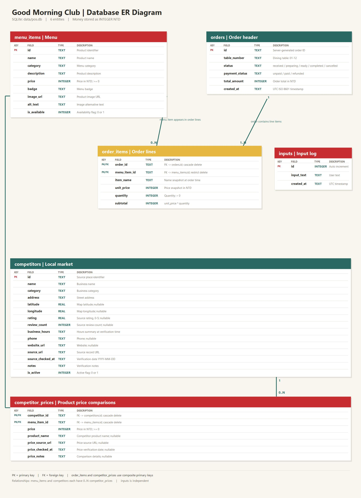
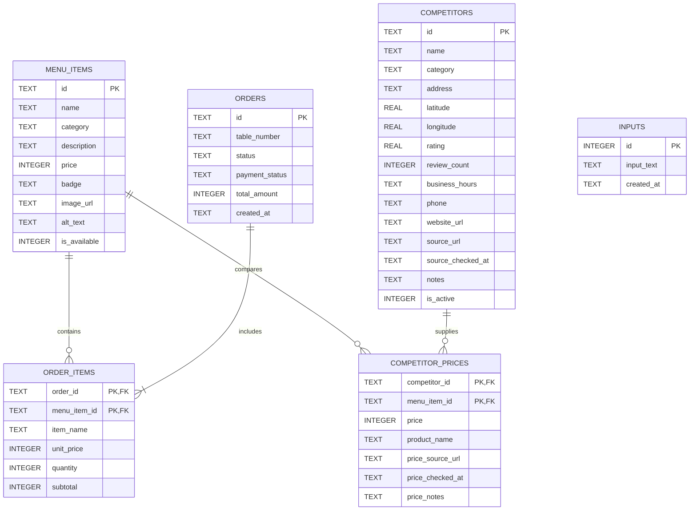

# SQLite ER 規格

## 資料庫

- 檔案：`data/pos.db`
- 引擎：SQLite
- 既有資料表：`menu_items`、`orders`、`order_items`、`inputs`、`competitors`、`competitor_prices`。
- 會員與紅利資料表及完整新 ERD：見 [會員紅利 ERD](../紅利績點/ERD.mmd)；實際遷移與欄位以 `src/loyalty_schema.py` 為準。
- 目前 ER 圖：
- 金額以新台幣整數儲存；資料庫時間為 UTC ISO 8601 字串。Dashboard 統計時轉換為 `Asia/Taipei`。

## ER 關聯

- 一個 `orders` 訂單至少包含一筆明細；每筆 `order_items` 必須屬於一筆訂單及一個菜單商品。
- 一個 `menu_items` 商品可被零筆或多筆訂單明細引用。
- `order_items` 的複合主鍵為 `(order_id, menu_item_id)`。
- `inputs` 是獨立資料表；目前 `/input` API 尚未實作。
- `competitor_prices` 以複合主鍵 `(competitor_id, menu_item_id)` 連結店家與菜單，並記錄價格來源；缺少資料列代表查無價格。
- 管理者帳號不存於資料庫，使用環境變數及簽章 session cookie。
- `orders.member_id` 可為 NULL 以保留訪客下單；會員訂單另記點數折抵及 `payable_amount`。會員 session、點數帳本、點數批次及折抵分配均保存在 SQLite。

## 初始競品資料

以下候選店家來自 Google 地圖於 `2026-11-06` 搜尋「早餐店 上石路 台中市西屯區」的結果。搜尋結果不代表指定半徑內的完整名單；評分、評論數和營業資訊可能變動，請由各筆 `source_url` 複查。

| 店家 | 類型 | 地址 | 地圖評分／評論 | 查詢時顯示的營業資訊 |
| --- | --- | --- | --- | --- |
| 大方早餐店 | 早餐店 | 青海路二段240-5號 | 4.3／223 | 週六 05:00 開始營業 |
| 春三朝午 | 早午餐餐廳 | 上石路179號 | 4.5／4,242 | 查詢時營業中，17:30 打烊 |
| 心饗晨坊 早午餐 | 早餐店 | 西屯路二段269-28號 | 4.1／557 | 週六 06:30 開始營業 |
| 尚美早餐店 | 早餐店 | 至善路118號 | 4.8／36 | 週六 06:00 開始營業 |
| 微早晨 We Brunch 手作早午餐 | 早餐店 | 櫻花路76號 | 4.0／492 | 查詢時顯示即將打烊 14:00，週六 06:30 開始營業 |

未查證到的電話、官方網站及價位保持空值，不以推測值補齊。

## 欄位字典

### `competitor_prices` 競品價格

| 欄位 | SQLite 型態 | 限制與說明 |
| --- | --- | --- |
| `competitor_id` | TEXT | 複合主鍵、外鍵 → `competitors.id`，刪除時連動刪除。 |
| `menu_item_id` | TEXT | 複合主鍵、外鍵 → `menu_items.id`，刪除時連動刪除。 |
| `price` | INTEGER | NOT NULL，非負整數，新台幣。 |
| `product_name` | TEXT | 可為 NULL，競品原始品名。 |
| `price_source_url` | TEXT | 可為 NULL，價格來源網址。 |
| `price_checked_at` | TEXT | 可為 NULL，價格查核日期。 |
| `price_notes` | TEXT | 可為 NULL，品項差異或收費備註。 |

### `menu_items` 餐點

| 欄位 | SQLite 型態 | 限制與預設值 | 說明 |
| --- | --- | --- | --- |
| `id` | TEXT | PRIMARY KEY | 唯一餐點識別碼；管理 API 接受小寫英數字與連字號。 |
| `name` | TEXT | NOT NULL | 餐點名稱。 |
| `category` | TEXT | NOT NULL | 菜單分類；有 `idx_menu_items_category` 索引。 |
| `description` | TEXT | NOT NULL | 餐點描述。 |
| `price` | INTEGER | NOT NULL，CHECK `>= 0` | 單價，新台幣元。 |
| `badge` | TEXT | NOT NULL | 菜單標籤。 |
| `image_url` | TEXT | NOT NULL | 商品圖片網址。 |
| `alt_text` | TEXT | NOT NULL | 圖片替代文字。 |
| `is_available` | INTEGER | NOT NULL，DEFAULT `1`，CHECK 為 `0` 或 `1` | 供應狀態；`1` 上架、`0` 下架。 |

### `orders` 訂單主檔

| 欄位 | SQLite 型態 | 限制與預設值 | 說明 |
| --- | --- | --- | --- |
| `id` | TEXT | PRIMARY KEY | 由後端產生的訂單識別碼。 |
| `table_number` | TEXT | NOT NULL，CHECK 為 `01` 至 `12` | 用餐桌號。 |
| `status` | TEXT | NOT NULL，DEFAULT `received`，受 CHECK 限制 | `received`、`preparing`、`ready`、`completed`、`cancelled` 之一。 |
| `payment_status` | TEXT | NOT NULL，DEFAULT `unpaid`，受 CHECK 限制 | `unpaid`、`paid`、`refunded` 之一。 |
| `total_amount` | INTEGER | NOT NULL，CHECK `>= 0` | 訂單總額，新台幣元。 |
| `created_at` | TEXT | NOT NULL，DEFAULT SQLite UTC 時間 | 建立時間，UTC ISO 8601。 |

### `order_items` 訂單明細

| 欄位 | SQLite 型態 | 限制與預設值 | 說明 |
| --- | --- | --- | --- |
| `order_id` | TEXT | 複合 PRIMARY KEY；FK → `orders.id`，ON DELETE CASCADE | 所屬訂單。 |
| `menu_item_id` | TEXT | 複合 PRIMARY KEY；FK → `menu_items.id`，ON DELETE RESTRICT | 餐點識別碼。 |
| `item_name` | TEXT | NOT NULL | 下單時餐點名稱快照。 |
| `unit_price` | INTEGER | NOT NULL，CHECK `>= 0` | 下單時單價快照，新台幣元。 |
| `quantity` | INTEGER | NOT NULL，CHECK `> 0` | 訂購數量。 |
| `subtotal` | INTEGER | NOT NULL，CHECK `= unit_price * quantity` | 明細小計，新台幣元。 |

### `inputs` 使用者輸入

| 欄位 | SQLite 型態 | 限制與預設值 | 說明 |
| --- | --- | --- | --- |
| `id` | INTEGER | PRIMARY KEY AUTOINCREMENT | 輸入紀錄流水號。 |
| `input_text` | TEXT | NOT NULL | 使用者輸入文字。 |
| `created_at` | TEXT | NOT NULL，DEFAULT SQLite UTC 時間 | 紀錄建立時間，UTC ISO 8601。 |

### `competitors` 競業資料

| 欄位 | SQLite 型態 | 限制與預設值 | 說明 |
| --- | --- | --- | --- |
| `id` | TEXT | PRIMARY KEY | 來源地點識別碼。 |
| `name` | TEXT | NOT NULL | 店家名稱。 |
| `category` | TEXT | NOT NULL | 店家類型，例如早餐店或早午餐餐廳。 |
| `address` | TEXT | NOT NULL | 地址。 |
| `latitude` | REAL | 可為 NULL | 來源地圖座標緯度。 |
| `longitude` | REAL | 可為 NULL | 來源地圖座標經度。 |
| `rating` | REAL | 可為 NULL，0 至 5 | 來源顯示評分。 |
| `review_count` | INTEGER | 可為 NULL，`>= 0` | 來源顯示評論數。 |
| `business_hours` | TEXT | 可為 NULL | 查核時來源顯示的營業資訊摘要。 |
| `phone` | TEXT | 可為 NULL | 電話；未查證者留空。 |
| `website_url` | TEXT | 可為 NULL | 官方網站；未查證者留空。 |
| `source_url` | TEXT | NOT NULL | 可回查該店家資訊的來源連結。 |
| `source_checked_at` | TEXT | NOT NULL，`YYYY-MM-DD` | 資料查核日期。 |
| `notes` | TEXT | NOT NULL，預設空字串 | 查核及資料限制備註。 |
| `is_active` | INTEGER | NOT NULL，DEFAULT `1`，限 `0` 或 `1` | `1` 顯示於管理列表；`0` 停用但保留資料。 |

## 完整性規則

- 每個 SQLite 連線需執行 `PRAGMA foreign_keys = ON`。
- 刪除訂單會連帶刪除明細；被訂單引用的菜單商品不可刪除，應以 `is_available = 0` 下架。
- `order_items.item_name` 與 `unit_price` 是建立訂單時的快照；後續修改菜單不會改變歷史訂單。
- 店家管理使用既有欄位維護商品及訂單狀態；競業管理使用獨立 `competitors` 表。
